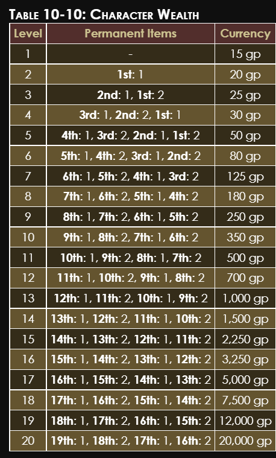

# Getting-started-guide

> REQUIREMENT #1 = ONLY JOIN IF YOU ARE 18+.
>> - Before you can join any Path Wars campaign, you must be 18+.
>> - If you are under 18, then I am afraid we cannot and will not let you play.
>> - Most players will be in their 20s and do not want to play with children.
>> - If you are under 18: PLEASE LEAVE THE DISCORD SERVER AND TELEGRAM GROUP.

> REQUIREMENT #2 = ONLY JOIN IF YOU ARE COMFORTABLE WITH THE [CONTENT WARNING](Content-warning.md).

> REQUIREMENT #3 = Commitment.
>> - ONLY JOIN IF YOU CAN COMMIT TO MULTIPLE SESSIONS / THE DURATION OF THE PLAY BY POST.
>> - SHOW UP TO SESSIONS / POST ON THE PLAY BY POST.
>> - PLAY IN THE LONG TERM.
>> - You can be AFK and lurk for as long as you like.

## Checklist.

> To join the campaign, please read the following steps:
>> - Meet the requirements (above this text).
>> - Read the [content warning](Content-warning.md) guide.
>> - Make your Pathfinder 2nd edition character in the ComeOnOver PF2e Character Creator (free, with dual class and free archetype built in): [https://comeonover.netlify.app/tools/pf2e-character-creator](https://comeonover.netlify.app/tools/pf2e-character-creator)
>> - Join the telegram group.
>> - Play with us! :3
>> - Get ready to play on Foundry: [Joining-foundry.md](Joining-foundry.md)

- If you need any help, ask on the discord server / telegram group!

## Level ranges.

> The level ranges for the campaigns are as follows:
>> - Campaign 1 Doomsday Funtime. Level 11 -> 20+.
>> - Campaign 1.5 Riddleport. Level 2 -> 20.
>> - Campaign 2 Crimson Throne. Level 1 -> 18. [COMPLETED].
>> - Campaign 3 Etran's Folly. Level 1 -> 4. [COMPLETED].
>> - Campaign 4 Agents of Magni Watch. Level 1 -> 20.
>> - Campaign 5 The Grand Explorers. Level 1 -> 20.
>> - Campaign 6 Kibwe. Level 6 -> 8.
>> - Campaign 7 StarFinder. Level 1 -> 15.

## Table of contents.
>> - Step 0 = Content Warning about Possible Content.
>> - Step 1 = Telegram.
>> - Step 2 = Discord.
>> - Step 3 = The Great Spoiler Warning.
>> - Step 4 = How to Build Your Character’s Life.
>> - Step 5 = Paizo Variant Rules.
>> - Step 6 = Talk to the Game Master, me!
>> - Step 7 = Character Creation (the ComeOnOver PF2e Character Creator).
>> - Step 8 = Foundry.
>> - Step 9 = Sign in to Foundry with your ComeOnOver account.
>> - Step 10 = Pick your player colour.
>> - Step 11 = Open your character sheet.
>> - Step 12 = Pick a token image.
>> - Step 13 = Request Vision Setup + Token Placement.
>> - Step 14 = Talk to the Game Master.
>> - Step 15 = Everything might be ready.

## Welcome!

> Before we go any further...
>> - This campaign is COMPLETELY FREE. Foundry is free, the telegram is free, discord is free.
>> - PLEASE READ STEP 0. It is for your comfort and the comfort of the other players.
>> - You do not need to know the lore. Experience the story as you play.
>> - You do not need to make a deep backstory. It is appreciated but definitely not required!
>> - Most of the variant rules are optional, you can be as vanilla as you like!
>> - No prior Pathfinder, dnd or TT-RPG experience is required to play with us; absolute noobs and hardened veterans are both completely welcome. :)
>> - There is a lot of information on this GitHub, you do not need to read any of it, we are just playing a game here, it is all just for fun. 
>> - The information is just here on GitHub for people to look up & reference if they want to.

> Unlocking the Discord.
>> - At the moment you will only be seeing a couple of public channels on the server, including the lobby.
>> - To unlock the rest of the server, please read the rest of the page.
>> - The “What To do Now” heading contains further information.

## What to do now!

1. Please read the content warning. This step describes the possible content that could come up in-game. Link: [Content-warning.md
](Content-warning.md)
2. Please decide if you consent to this content being possibly in the game.
3. Go to the ✅-join-the-campaign channel and tick the ✅ emoji.

## Telegram.
> Telegram.
>> - We use Telegram for out-of-game chat and some in-session links and image sharing.
>> - The link to the Telegram group is below.
>> - All the links do the same thing.
>> - Click the link: [https://t.me/Path_Wars](https://t.me/Path_Wars)

## Discord.
> Discord.
>> - Discord invite link: [https://discord.gg/nAxna2DBk7](https://discord.gg/nAxna2DBk7).

## Spoilers.
> The Great Spoiler Warning.
>> - Read = [https://github.com/LewisIsWorking/PathWarsWiki/blob/main/Writerside/topics/Cross-campaign-lore/Spoiler-avoidance-guide.md](https://github.com/LewisIsWorking/PathWarsWiki/blob/main/Writerside/topics/Cross-campaign-lore/Spoiler-avoidance-guide.md).

## Build Your Character's Lore.
>> - Go here and paste the table onto your writerside instance OR your word processor of choice: [Character-Lore-Builder.md.](Character-Lore-Builder.md)
>> - If you need information on the world, check out: [Golarion-Lore-The-Spoiler-Free-Version.md.](../Cross-campaign-lore/Golarion-Lore-The-Spoiler-Free-Version.md)
>> - Send me your character's lore, and I will add it to this wiki.

## Paizo Variant Rules.
>> - YOU DO NOT NEED TO USE A VARIANT RULE IF YOU DO NOT WANT TO. 
>> - You do not need to use dual class, free archetype, etc. 
>> - You can make a single class non-free-archetype character if you wish to do so.
>> - Please read the following page: [Official-paizo-variant-rules.md](Official-paizo-variant-rules.md)
>> - You can find out what Paizo Variant rules are used on the page linked above!
>> - The campaigns ran in the Path War community have some homebrew rule changes. 
>> - You can find a mostly complete list of the rule changes here: [Homebrew-rules.md](../Extra-rules/Homebrew-rules.md)

## Character Creation.
>> - Time to actually make your character's stats and abilities.

> The ComeOnOver PF2e Character Creator.
>> - Make your character here: [https://comeonover.netlify.app/tools/pf2e-character-creator](https://comeonover.netlify.app/tools/pf2e-character-creator)
>> - It is free. You do NOT need to buy anything.
>> - Dual class, free archetype and our other variant rules are built in: switch them on in its Optional Rules step.
>> - The Discord bot sends you this link in your channel too, and walks you through the rest.
>> - When your character is done, press "My character is finished" in your Discord channel. A GM checks it and it goes into Foundry for you.

> Enable the variant rules.
>> - Enable the variant rules that are applicable to your campaign.
>> - To find out what variant rules you need to enable, check here: [Official-paizo-variant-rules.md.](Official-paizo-variant-rules.md)

> What about Pathbuilder 2e?
>> - You do not need Pathbuilder. It is fine for planning, but your Foundry sheet is what counts.
>> - Players have told us Pathbuilder no longer lets you switch on Dual Class for free. The ComeOnOver creator does it for free.
>> - If you still want to use it, the old setup is here: [Pathbuilder-setup.md](Pathbuilder-setup.md)

> NOTE ABOUT = Selecting 3rd party content:
>> - **3rd Party Content.**
>> - Check the 3rd party page to find out what is available: [3rd-party-content-and-options.md.](../Extra-rules/3rd-party-content-and-options.md)
>> - 3rd Party content may not be selectable in the character creator due to it not being official Paizo content.
>> - To use 3rd party content, you will need to add it in Foundry manually.
>> - Ask me about this! 
>> - Some 3rd party content may already be available in Foundry thanks to community modules.

> NOTE ABOUT = Uncommon, Rare and Unique equipment, feats, spells and races.
>> - Before selecting anything with these traits, make sure you read: [Rarity-lock-status-tracker.md.](../Extra-rules/Rarity-lock-status-tracker.md)
>> - You can play ANY background, class and/or race, regardless of their rarity.

> Create your character.
>> - To create your character, set your character's level in the creator to the level they will be playing at.
>> - To find out what level your character should be set to, ask the discord.
>> - Now fill out your character in the creator.
>> - Pick your class, pick your race and pick your subrace. 
>> - Go through each level and apply all your ability score boosts, make your feat selections, etc.

> Pick your equipment.
>> - Here is the Starting Wealth table: 
>> - 
>> - This table explains what items you start with.
>> - You need to consult the table by using your level to determine what equipment you start with.
>> - [Treasure for New Characters](https://2e.aonprd.com/Rules.aspx?ID=2662&Redirected=1)

> Examples of equipment.:
>> - 9th Level Items. One 8th. Two 7th. One 6th. Two 5th. 250 GP.
>> - 11th Level Items. One 10th, two 9th, one 8th, two 7th. 
>> - 12th Level Items. One 11th. Two 10th. 1 9th. 2 8th. 700 GP. 
>> - 13th Level Items. 12th level item x 1. 11th level item x 2. 10th level item x 1. 9th level item x 2. 1,000 Gold Pieces.

> Bag of holding costs.**
>> - Type 1 = 4th level item. 75 GP. 
>> - Type 2 = 7th level item. 300 GP. 
>> - Type 3 = 11th level item. 1,200 GPs. 
>> - Type 4 = 13th level item. 2,400 GPs.

> Apply lore increases. 
>> - You can read about the lore increases homebrew rule here: [Homebrew-rules.md.](../Extra-rules/Homebrew-rules.md)

## What is the Time Zone of the GM?

> It's Dublin/London.

## The Final step. Everything might be ready?
**And with that, we should be ready to roll the dice, kill shit and have fun.** 😃.
> Make sure to complete the [Character-Lore-Builder](Character-Lore-Builder.md)

## Change log.

> 2025-06-18.
>> - Massively restructured, shorted and refactored (broke out) chunks of the guide into their own pages in the info folder.

> 2025-01-19.
>> - Changed formatting.

> 13/08/2024.
>> - Ross gave me a LOT of feedback, so I have made a lot of changes.

> 24/01/2023.
>> - This guide was once 25 separate pages. 
>> - I got a lot of feedback that stated that having all these pages being separate was clunky, hard to navigate and hard to read. 
>> - So I have instead made it one longer page. 
>> - People enjoy this change, hopefully.
