# Invoked practice sheet

Lines to learn before the 21 Nov tournament so you can play them from memory under the timer. Every line only uses cards Lewis owns.

- **Sourced** lines come from Taffy's [Invoked combo spreadsheet](https://www.masterduelmeta.com/spreadsheet/6ac95807501c79d600eec076) on Master Duel Meta (Sept–Oct 2026) and are copied step for step.
- **Untested** lines were built from card text by Claude. Each step was checked against the card, but nobody has played them in a tournament.
- Chorozo crafted 14 Nov, so Line 1 now uses Taffy's Baronne branch.

## Cheat sheet images

One image per line, for your phone during games. **Easier on a phone:** the one-page version at https://claude.ai/artifact/QN9EBixbg3USELrswv3fw3 always shows the latest lines (add it to your home screen). **Current version: v1.3 (14 Nov 2026).** Version and date are printed in each image's footer.

To update: edit the line data in `tools/invoked-cheatsheet/build.py`, bump `VERSION` and `DATE`, run `python3 tools/invoked-cheatsheet/build.py` from the repo root, point the links below at the new folder, and add a changelog entry. Older versions stay in their own folders.

### Changelog

- **v1.3 (14 Nov 2026):** lines renumbered so the picker reads 1 → 11 top to bottom (old numbers: 4→1, 6→2, 3→3, 5→4, 1→5, 2→6, 7→7, 9→8, 10→9, 8→10, 11→11). The two opener rows are merged into Line 2. Entries below have been updated to the new numbers.
- **v1.2 (14 Nov 2026):** added Line 8 (Aleister got Drolled) and Line 9 (Reminiscent got Drolled) from Taffy, both now possible with Chorozo; Line 11 going-second finishers (spare Sword → Omega, Super Poly with Madness, damage tricks, attack values). Line 5 notes the Omega finish.
- **v1.1 (14 Nov 2026):** added a discard priority and a Mechaba hand rule to the "Which line?" golden rules.
- **v1.0 (14 Nov 2026):** first version. Lines 1–8 plus the "Which line?" picker. Line 1 is Taffy's Baronne branch (Chorozo crafted). Deck: 1 Reminiscent, 2 Aiwass, 2 Spenta, 1 Crowley, 1 Zoroa, Omega + 1 Aeon + De Anima in the Extra Deck.
- **Planned:** add Elysium to Line 4 and the going-second plan once crafted; add Gamma Summon; recheck lines when Reminiscent #2–3 arrive.

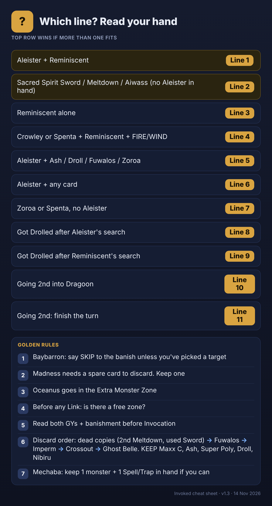
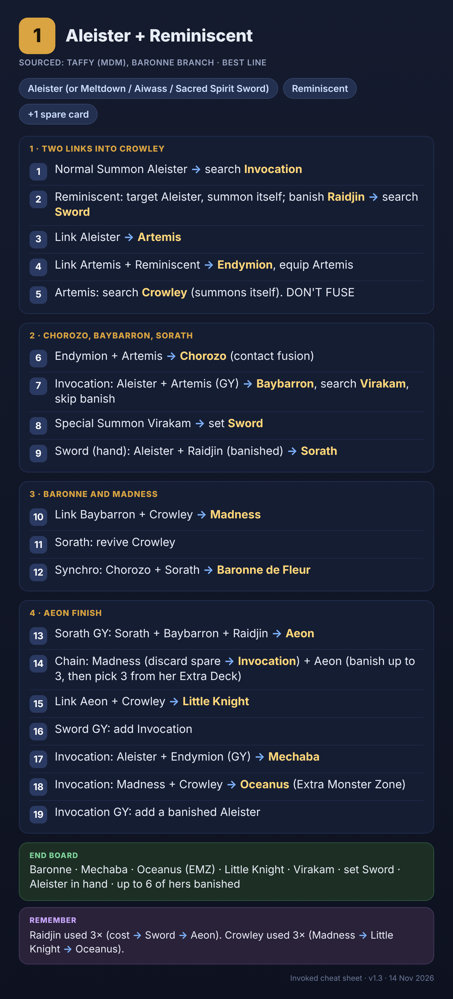
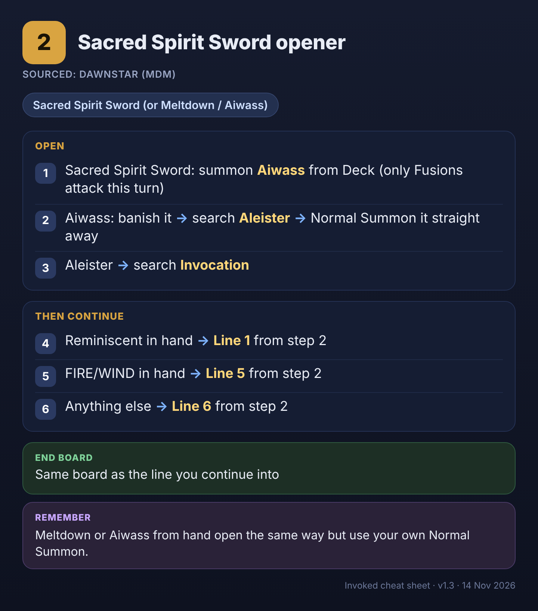
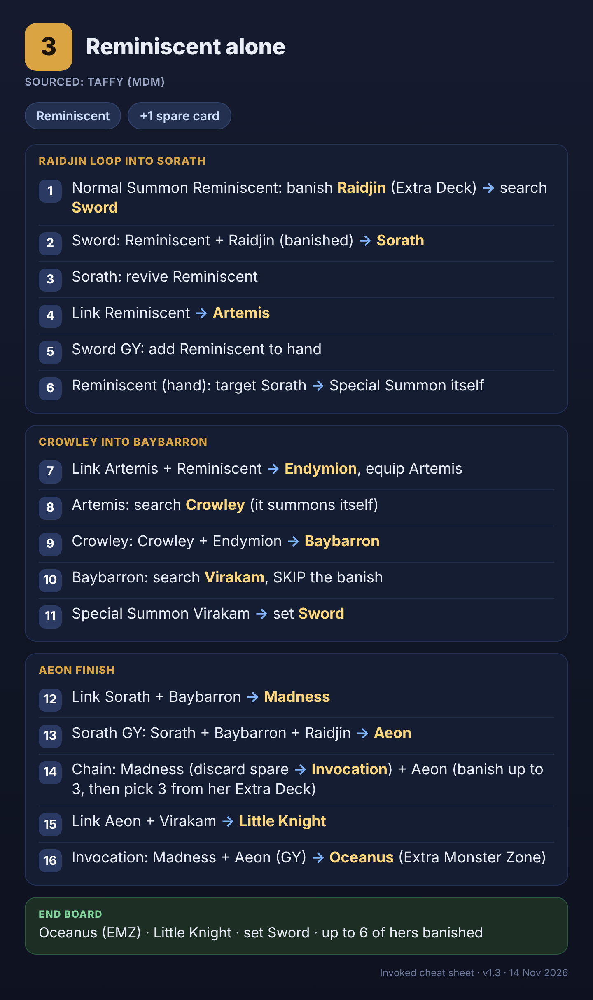
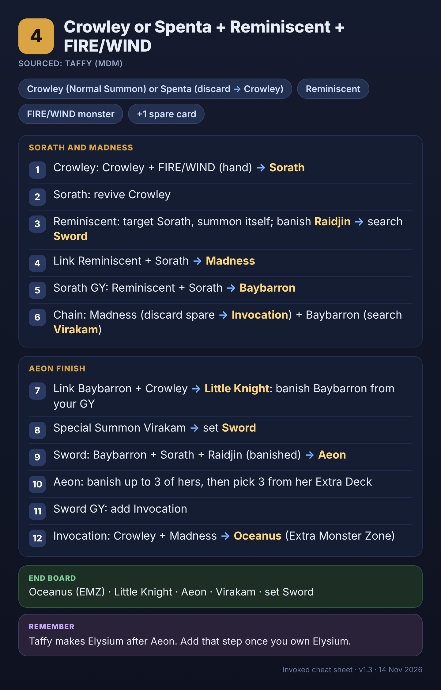
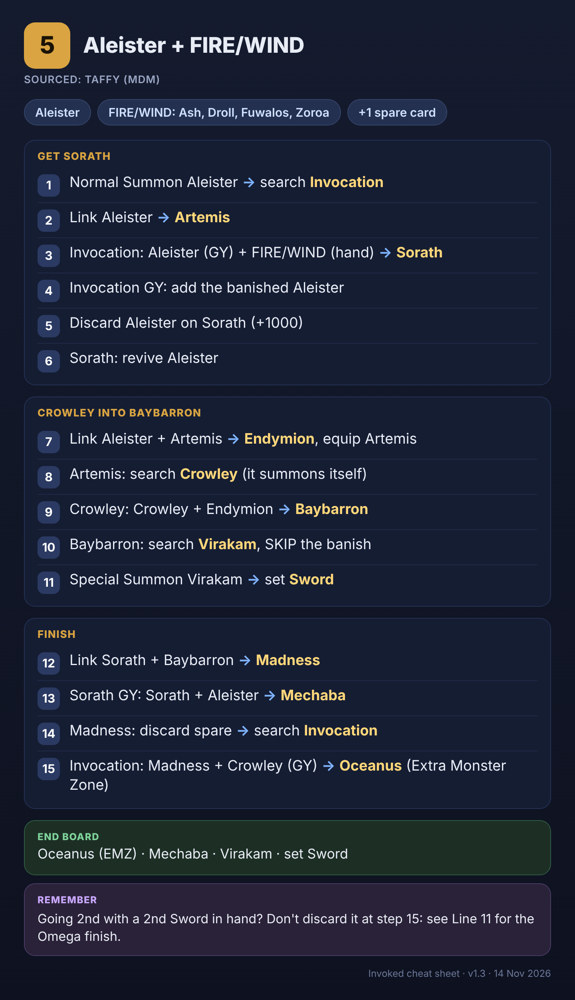
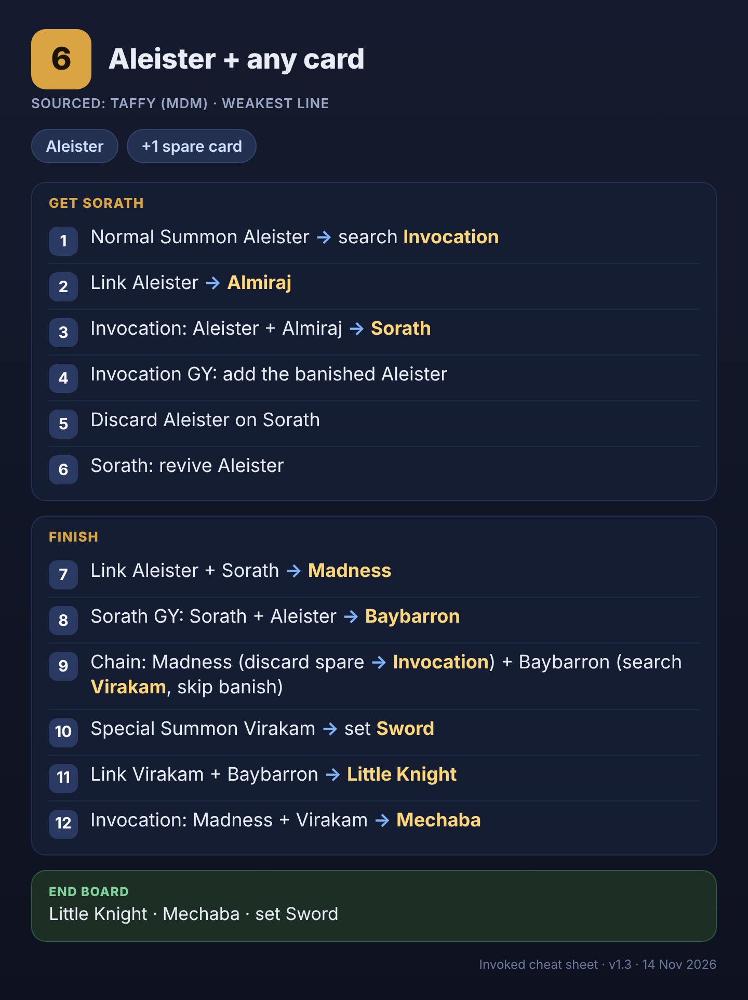
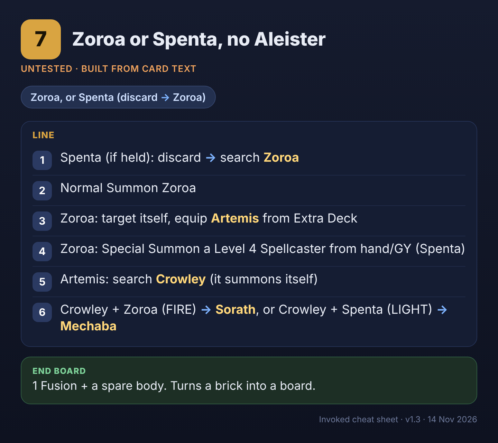

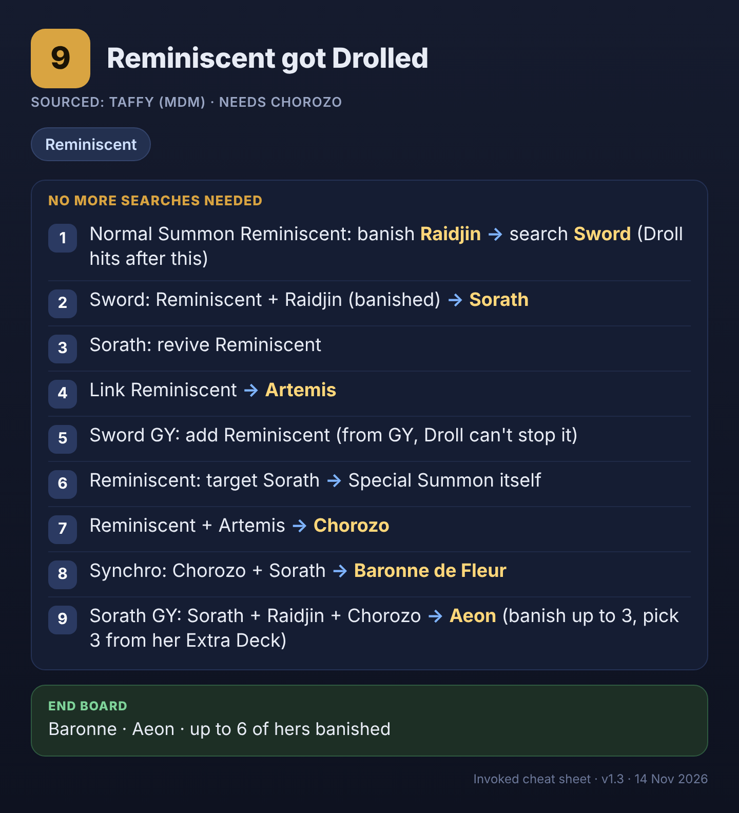
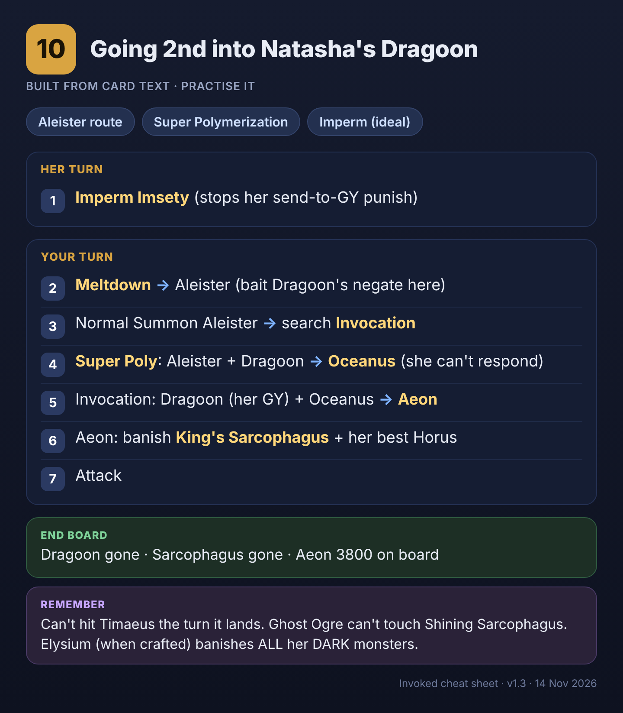
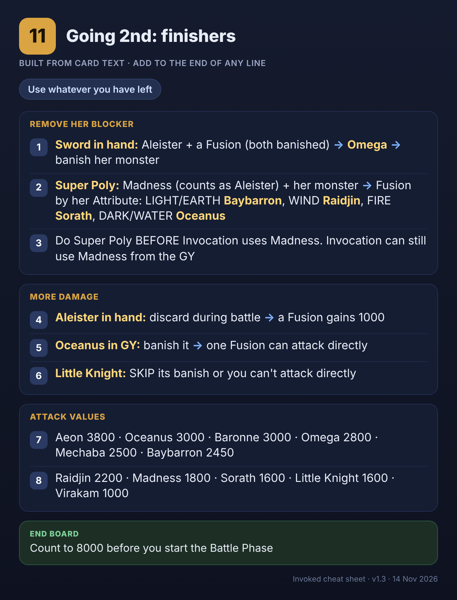

Which line to play:

| Your hand has | Play |
| --- | --- |
| Aleister + Reminiscent (+1 spare) | Line 1 (best) |
| Sacred Spirit Sword / Meltdown / Aiwass, no Aleister in hand | Line 2 (opener, then 1, 5 or 6) |
| Reminiscent | Line 3 |
| Spenta or Crowley + Reminiscent + Ash/Droll/Fuwalos | Line 4 |
| Aleister + Ash / Droll / Fuwalos / Zoroa / Aiwass | Line 5 |
| Aleister + any other card | Line 6 |
| Zoroa or Spenta, no Aleister | Line 7 |
| Got Drolled after Aleister's search | Line 8 |
| Got Drolled after Reminiscent's search | Line 9 |
| Going second into Dragoon | Line 10 |
| Going second: finish the turn | Line 11 |

## Line 1: Aleister + Reminiscent + 1 spare card (sourced: Taffy, "Aleister the Invoker + Aleister the Reminiscent", Baronne branch)

Needs: Aleister (or Meltdown / Aiwass / Sacred Spirit Sword to get one) + Reminiscent + **any 1 spare card** for Madness's discard. Deck: Invocation ×2, Sword ×2, Crowley, Virakam. Extra Deck: Artemis, Endymion, Chorozo, Raidjin, Sorath, Baybarron, Madness, Baronne, Aeon, Little Knight, Mechaba, Oceanus.

**Stage 1: two Links into Crowley**
1. Normal Summon Aleister, search Invocation
2. Reminiscent (hand): target Aleister, Special Summon itself; banish **Raidjin** from Extra Deck, search **Sword**
3. Link Aleister → Artemis
4. Link Artemis + Reminiscent → Endymion; Endymion equips Artemis to itself
5. Artemis: search Crowley, which summons itself. **Don't fuse.**

**Stage 2: Chorozo, Baybarron, Sorath**
6. Endymion + Artemis → **Chorozo** (contact fusion)
7. Invocation: banish Aleister + Artemis (GY) → **Baybarron**, search Virakam (skip the banish)
8. Special Summon Virakam, set **Sword**
9. Sword (hand): Aleister + Raidjin (both banished) → **Sorath**

**Stage 3: Baronne and Madness**
10. Link Baybarron + Crowley → **Madness**
11. Sorath: revive Crowley
12. Synchro: Chorozo + Sorath → **Baronne de Fleur**

**Stage 4: Aeon and the finish**
13. Sorath GY: banish Sorath + Baybarron + Raidjin → **Aeon**. Chain: Madness (discard the spare card, search Invocation) + Aeon (3 materials: banish up to 3 cards from the field/GYs, then look at their Extra Deck and banish up to 3 you choose). Virakam protects Aeon.
14. Link Aeon + Crowley → **S:P Little Knight**
15. Sword GY: add Invocation
16. Invocation: Aleister + Endymion (GY, LIGHT) → **Mechaba** (Taffy: "can make Mechaba here if doing the Baronne combo"; Endymion as the LIGHT material is Claude's reading)
17. Invocation: Madness + Crowley → **Oceanus** in the Extra Monster Zone
18. Invocation GY: add a banished Aleister

**End:** Baronne, Mechaba, Oceanus (Extra Monster Zone), Little Knight, Virakam, set Sword, Aleister in hand; up to 6 of their cards banished (3 field/GY + 3 chosen from their Extra Deck).

**Ideas to remember:** Raidjin is used three times (Reminiscent's cost → Sword material → Aeon material). Crowley is used three times (Madness material, Little Knight material, Oceanus material). Invocation and Sword both recycle from the GY.

## Line 2: Sacred Spirit Sword (opening sourced: Dawnstar, "Aiwass Spell 1 Card Combo"; finish is Line 6)

1. Sacred Spirit Sword: Special Summon Aiwass from Deck (only Fusions can attack this turn)
2. Aiwass: banish it from the field, search Aleister, Normal Summon Aleister right away
3. Aleister: search Invocation
4. Continue from **Line 6, step 2**. If you also hold a FIRE/WIND monster, continue from **Line 5, step 2** instead.

Meltdown (search Aleister) and Aiwass from hand (banish to search Aleister) open the same way, but use your normal Normal Summon.

## Line 3: Reminiscent alone (sourced: Taffy, "Aleister the Reminiscent 1 card combo")

1. Normal Summon Reminiscent: banish Raidjin from Extra Deck, search Sword
2. Sword: Reminiscent + Raidjin (from banishment) → Sorath
3. Sorath: revive Reminiscent
4. Link Reminiscent → Artemis
5. Sword GY: add Reminiscent back to hand
6. Reminiscent (hand): target Sorath, Special Summon itself
7. Link Artemis + Reminiscent → Endymion
8. Endymion: equip Artemis; Artemis searches Crowley
9. Crowley summons itself: Crowley + Endymion → Baybarron
10. Baybarron: search Virakam
11. Special Summon Virakam, set Sword
12. Link Sorath + Baybarron → Invoker of Madness
13. Sorath GY: banish Sorath + Baybarron + Raidjin → Aeon
14. Chain: Madness (discard 1, search Invocation) + Aeon (3 materials: banish up to 3 cards, then pick 3 from their Extra Deck); Virakam protects Aeon
15. Link Aeon + Virakam → S:P Little Knight
16. Invocation: Madness + Aeon (GY) → Oceanus in the Extra Monster Zone

**End:** Oceanus (Extra Monster Zone), Little Knight, set Sword, up to 6 of their cards banished.

## Line 4: Crowley + Reminiscent + FIRE/WIND (sourced: Taffy, "I drew Crowley")

**Spenta version:** discard Spenta to search Crowley. Crowley Special Summons itself because it was added to your hand, so carry on from step 1 (card text, not tested).

1. Crowley: Crowley + FIRE/WIND (hand) → Sorath
2. Sorath: revive Crowley
3. Reminiscent (hand): target Sorath, Special Summon itself; banish Raidjin, search Sword
4. Link Reminiscent + Sorath → Invoker of Madness
5. Sorath GY: banish Reminiscent + Sorath → Baybarron
6. Chain: Madness (discard 1, search Invocation) + Baybarron (search Virakam)
7. Link Baybarron + Crowley → S:P Little Knight; banish Baybarron from your GY
8. Special Summon Virakam, set Sword
9. Sword: Baybarron + Sorath + Raidjin (all banished) → Aeon
10. Aeon: banish 2 of your own GY Fusions (Raidjin, Sorath), then 3 from their Extra Deck
11. Invocation: banish Aeon + Baybarron → Elysium (skip if not owned)
12. Sword GY: add Invocation
13. Invocation: Crowley + Madness → Oceanus in the Extra Monster Zone

## Line 5: Aleister + a FIRE or WIND monster (sourced: Taffy, "Aleister 1.5 Card Combo")

1. Normal Summon Aleister, search Invocation
2. Link Aleister → Artemis
3. Invocation: Aleister (GY) + FIRE/WIND (hand) → Sorath
4. Invocation GY: add the banished Aleister
5. Discard Aleister targeting Sorath (+1000)
6. Sorath: revive Aleister
7. Link Aleister + Artemis → Endymion
8. Endymion: equip Artemis (GY) to Endymion
9. Artemis: search Crowley, which Special Summons itself
10. Crowley: Crowley + Endymion → Baybarron
11. Baybarron: search Virakam
12. Special Summon Virakam, set Sword
13. Link Sorath + Baybarron → Invoker of Madness
14. Sorath GY: banish Sorath + Aleister → Mechaba
15. Madness: discard 1 card, search Invocation
16. Invocation: Madness + Crowley (GY) → Oceanus in the Extra Monster Zone

**End:** Oceanus (Extra Monster Zone), Mechaba, Virakam, set Sword.

## Line 6: Aleister + any card (sourced: Taffy, "Aleister the Invoker 1 card combo")

1. Normal Summon Aleister, search Invocation
2. Link Aleister → Almiraj
3. Invocation: banish Aleister + Almiraj → Sorath
4. Invocation GY: add Aleister
5. Discard Aleister targeting Sorath
6. Sorath: revive Aleister
7. Link Aleister + Sorath → Invoker of Madness
8. Sorath GY: banish Sorath + Aleister → Baybarron
9. Chain: Madness (discard 1, search Invocation) + Baybarron (search Virakam)
10. Special Summon Virakam, set Sword
11. Link Virakam + Baybarron → S:P Little Knight
12. Invocation: banish Madness + Virakam → Mechaba

**End:** Little Knight, Mechaba, set Sword. Taffy calls this the weakest line.

## Line 7: Zoroa or Spenta with no Aleister (untested, built from card text)

1. Spenta (if held): discard, search Zoroa
2. Normal Summon Zoroa
3. Zoroa: target itself, equip Artemis from the Extra Deck
4. Zoroa (now equipped): Special Summon a Level 4 Spellcaster from hand or GY in Defence, effects negated (Spenta)
5. Artemis (equipped): search Crowley, which summons itself
6. Crowley: Crowley + Zoroa (field, FIRE) → **Sorath**, or Crowley + Spenta (field, LIGHT) → **Mechaba**

**End:** one Fusion plus a spare body. It's a short line: it turns a hand with no Aleister into a board, nothing more. If you draw into Aleister later, Sorath's GY effect and Invocation take over.

## Line 8: Aleister got Drolled (sourced: Taffy, "Aleister Droll combo")

1. Normal Summon Aleister, search Invocation (Droll after)
2. Link Aleister → Artemis
3. Invocation: Aleister (GY) + FIRE/WIND (hand) → Sorath
4. Invocation GY: add the banished Aleister (not from the Deck, so Droll can't stop it)
5. Discard Aleister on Sorath; Sorath revives Aleister
6. Aleister + Artemis → Chorozo
7. Synchro: Chorozo + Sorath → Baronne de Fleur
8. Sorath GY: Sorath + Aleister → Mechaba

**End:** Baronne, Mechaba.

## Line 9: Reminiscent got Drolled (sourced: Taffy, "Aleister the Reminiscent Droll combo")

1. Normal Summon Reminiscent: banish Raidjin, search Sword (Droll after)
2. Sword: Reminiscent + Raidjin (banished) → Sorath
3. Sorath: revive Reminiscent
4. Link Reminiscent → Artemis
5. Sword GY: add Reminiscent
6. Reminiscent: target Sorath, Special Summon itself
7. Reminiscent + Artemis → Chorozo
8. Synchro: Chorozo + Sorath → Baronne de Fleur
9. Sorath GY: Sorath + Raidjin + Chorozo → Aeon (banish up to 3, then pick 3 from her Extra Deck)

**End:** Baronne, Aeon.

## Line 10: going second into Dragoon (from card text)

- **Super Polymerization:** discard 1, fuse Dragoon (DARK) with an Aleister (or face-up Crowley) → Oceanus. She can't respond. Use it on Dark Magician of Destruction before Gaze turns it into Dragoon.
- **Grail mode 2:** banish your Aleister + her face-up Dragoon → Oceanus. Grail doesn't target. Needs an Aleister in your field, GY or banishment first.
- **Neither works on Timaeus the United Magical Dragon** the turn it's summoned or her next turn (unaffected).
- **Shining Sarcophagus can't be destroyed by monster effects** (Ghost Ogre does nothing to it).

## Line 11: going-second finishers (card text)

- **Spare Sword in hand:** Aleister + a Fusion (both banished) → Omega; Omega banishes her monster. Don't discard this Sword to Madness.
- **Super Poly:** Madness (counts as Aleister) + her monster → Fusion by her Attribute (LIGHT/EARTH Baybarron, WIND Raidjin, FIRE Sorath, DARK/WATER Oceanus). Do it before Invocation uses Madness.
- **Aleister in hand:** discard in battle for +1000. **Oceanus in GY:** banish it so a Fusion attacks directly. **Little Knight:** skip its banish if you need direct attacks.

## Discard priority (Madness, Mechaba, Super Poly, Spenta costs)

Discard the card that does least on **her** turn. Once you control cards, Fuwalos and Imperm-from-hand are dead.

1. Dead copies: 2nd Meltdown, a Sword when another is set, Sacred Spirit Sword after you've used one
2. Mulcharmy Fuwalos
3. Infinite Impermanence (unless you'll set it)
4. Crossout Designator
5. Ghost Belle

**Keep:** Maxx "C", Ash, Super Polymerization, Droll, Nibiru, Ghost Ogre. For Mechaba, try to hold 1 monster and 1 Spell/Trap so it can negate either type.

## Hand-card Attributes (for Invocation from hand)

Checked on YGOPRODeck, 14 Nov 2026. With Aleister, each one makes:

| Card | Attribute | Aleister + it makes |
| --- | --- | --- |
| Ash, Zoroa | FIRE | Sorath |
| Fuwalos, Droll, Aiwass | WIND | Sorath or Raidjin |
| Maxx "C", Ghost Belle | EARTH | Baybarron |
| Ghost Ogre, Nibiru, Spenta | LIGHT | Mechaba or Baybarron |
| Crowley | DARK | Caliga or Oceanus |

Spend the card lowest on the discard priority. A FIRE/WIND card makes it Line 5, which beats Line 6.

## Lessons from live games (14 Nov 2026)

- **Read both GYs and the banishment before every Invocation.** Invocation banishes from **either** GY. Her Sword returning Fusions from banishment to her GY made **Aeon** possible (and better than Caliga); missed it, then lost to the timer.
- **Her Magical Meltdown face-up = her Invocation, Sword, Grail and Super Poly can't be negated.** Don't spend Mechaba's discard on them; save the discard for Super Poly.
- **One discard, two uses:** Mechaba and Super Poly both cost a card from hand. Decide which one gets it before her turn starts.
- **Super Poly from a set position is best on her turn after she has 2+ Fusions:** fuse them into your Aeon.
- **Ghost Ogre can't destroy Shining Sarcophagus** (it can't be destroyed by monster effects).
- **Timer:** send the screenshot at the start of the turn; under 30 seconds, act on your own read.

### Game log: Planet Run vs Invoked mirror, went first (14 Nov 2026)

Hand: Ghost Ogre, Fuwalos, Crowley, Sacred Spirit Sword, Sword. Imperm'd Aleister's search.

Mistakes (Claude's calls):
1. **Didn't say "skip Baybarron's banish".** Baybarron's on-summon banish hit Madness in our GY, so Virakam had no Aleister to enable it and the planned Invocation → Mechaba was lost. **Rule: every Baybarron step says "skip the banish" unless a target is named.**
2. **Planned a Link (Little Knight) with Oceanus in the Extra Monster Zone.** Links need the Extra Monster Zone or a zone a Link points to; with Oceanus there and no Link arrows, the game demanded Oceanus as material. **Rule: before any Link, check a legal zone exists.**
3. **Line changed mid-combo** (Aiwass GY summon, then Oceanus early) without re-checking what each later step needed (Aleister in GY for Virakam).

What went right: Sword using the banished Aiwass (WIND) as material after Imperm stopped the search.

## Checklist before giving any line

1. Read both GYs, both banishment zones, and every face-up card (e.g. their Meltdown).
2. For each step, check what it needs (Aleister on field/GY? discard? free zone?) and that an earlier step doesn't remove it.
3. Every optional banish/search: say exactly what to pick, or "skip".
4. Links: confirm a legal zone. Fusions from the Extra Deck can go to Main Monster Zones; Links can't.
5. Name which card is the discard for Mechaba / Super Poly.
6. After every game: add mistakes and fixes to this page.

### Game log: Planet Run vs DoomZ (14 Nov 2026): time limit loss

- Lost on **total duel time**: 8:50 used vs her 5:32, in only 3 turns. Most of it was waiting on Claude's long replies.
- **Fix:** play the practice-sheet lines from memory without asking; ask Claude only for unusual spots; Claude replies in one or two lines during games.
- **Lewis's find:** Aleister searched Invocation, then **Invocation banished Oceanus (GY, EARTH) + Baybarron (FIRE) → Hyperinvoked Aeon**. Aeon needs **no Aleister**, just 2+ Fusions with different Attributes, and Invocation can banish them from your field and GY. Claude had wrongly said "nothing works without an Aleister". **Rule: always check GY Fusions for an Aeon.**
- **Aiwass in the GY is a free extender:** whenever a face-up Fusion you control is sent to the GY (not by battle), e.g. as Link material for Little Knight or Madness, Aiwass Special Summons itself, then you can Fusion Summon an Invoked using monsters from hand or field. Look for it every time a Fusion leaves the field.

### Game log: Planet Run vs Witchcrafter, went second (14 Nov 2026): win

- Hand: Droll, Ash, Reminiscent, Aiwass, Meltdown (+ drew Crowley). Opponent opened Witchcrafter Genni + a Spell, then Madame Verre.
- Opponent surrendered on turn 2 after Meltdown → Aleister → Aiwass. Used 1:44 of clock: short replies worked.
- **Witchcrafter Madame Verre** (UR, LIGHT Level 8 Spellcaster, 1000/2800): Quick Effect, discard a Spell to negate all your **currently** face-up monsters this turn; damage calculation: reveal Spells to gain 1000 attack each. Monsters you summon after it resolves are unaffected; Virakam stops it if she uses it on a Fusion's effect.

### Game log: Planet Run vs Hecahands (Tim), went first (14 Nov 2026)

- **Missed a free Sorath revive on our own turn.** Sorath's Quick Effect is once per turn in **each** Main Phase, so use it on your turn (e.g. revive Droll as a blocker or material) and again on theirs.
- **Grail needs an Aleister in your field, GY or banishment before you activate it.** One in hand doesn't count.
- Know which deck is in use: the Planet Run deck has no Ghost Ogre. Claude must check the deck list before naming Deck monsters for Grail.
- Sacred Spirit Sword's third mode (banish 1 of 3 random Extra Deck cards) summons nothing, so it's safe against Fuwalos. Hit Hecahands Xeno.
- **Result: loss on turn 2.** She ran 2+ Hecahands Xeno: the second Xeno summoned our Baybarron from our Extra Deck, our Mechaba was stolen, and Xeno 3400 + Mechaba 2500 + Baybarron 2450 attacked for lethal.
- **Lessons vs Hecahands:** a 2-monster board with only a Spell discard for Mechaba isn't enough. Keep a **monster** in hand for Mechaba so it can negate Xeno's Quick Effect. The Sacred Spirit Sword Extra Deck rip only hits 1 of 3 random cards, so expect a second Xeno. Her Fuwalos draws made her hand big; going first, consider making fewer summons until her Fuwalos turn is over.

### Game log: Planet Run, went first, Ash + Fuwalos (14 Nov 2026): loss

- Ash hit Aleister's search; she also used Fuwalos. Claude switched to Line 3, then changed it again mid-turn to save summons. Lewis got lost following the changing steps and ended on Aeon + Virakam + Imperm only.
- **Lesson:** when the plan breaks mid-combo, Claude gives **one** replacement line and sticks to it. Under the clock, a simple board played confidently beats a better line half-finished.
- **Practise Lines 1 and 3 against the AI** until they're automatic; then a broken line is recognisable without help.

### Game log: Planet Run vs Fiendsmith / Horus / Dark Magician, went first (14 Nov 2026): loss

- Our Aeon was removed; **Aiwass revived itself from the GY** (good), but with no Aleister it couldn't fuse.
- Claude named **Ghost Ogre**, which wasn't in hand. **Rule: read the hand from the screenshot every time.**
- **Nibiru** after her 9th summon tributed her board, but she rebuilt (Little Knight, Hapi, Imsety, Destruction, Rank 8).
- Caliga in Defence was removed by Little Knight's banish, so it didn't stop the attacks. Against a board with Little Knight, Caliga alone isn't protection.

### Game log: ranked vs Red-Eyes Dragoon, went first (14 Nov 2026): loss

- End board: Oceanus (Extra Monster Zone), Mechaba, Baybarron, Virakam, Meltdown, set Imperm; hand Ash + 2 Aleister.
- Opponent **Super Polymerization**'d Mechaba + Virakam into Mudragon of the Swamp (can't be responded to), made **Red-Eyes Dark Dragoon**, destroyed Oceanus for 3000 burn, then attacked.
- **Lessons:** Super Poly beats a negate board; nothing stops it. Save **Ash for the Dragoon route** (Red-Eyes Fusion uses Deck monsters, so Ash can negate it; Destruction's Gaze search too). Keep a **monster** in hand for Mechaba: Dragoon's destroy/burn is a monster effect.
- Lewis used **Ash on Magician's Rod's search** and **set Imperm on Rod to negate Triple Tactics Talent through Imperm's column effect** (a set Imperm also negates other Spell/Trap effects in its column that turn). Good plays; the loss came from Super Poly + Dragoon.

### Practice log: Solo, Line 5 going second (14 Nov 2026): win

- Discarded the hand Sword at step 15 (the sheet didn't say to keep it), so no Omega finish. Fixed in v1.2 (Line 5 note + Line 11).
- **Once Super Poly is activated you can't cancel it.** Madness was already banished for Oceanus, so the only legal fusion was Mechaba + Oceanus → Aeon. Order matters: Super Poly before Invocation uses Madness.
- Won anyway next turn with Aeon + Omega (2800 for the final hit) vs the Archfiend AI.
