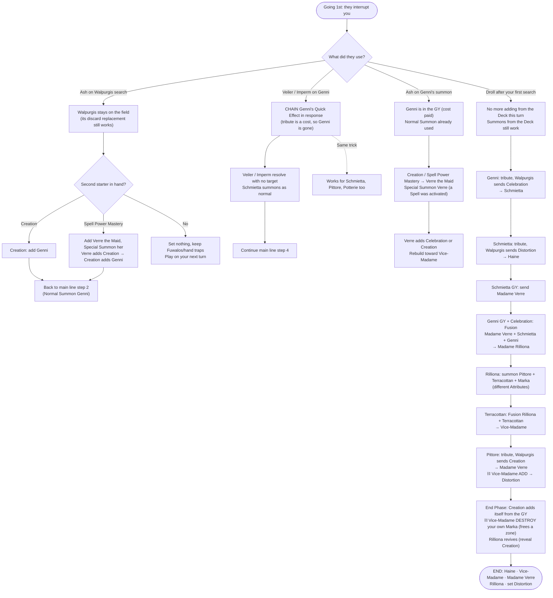
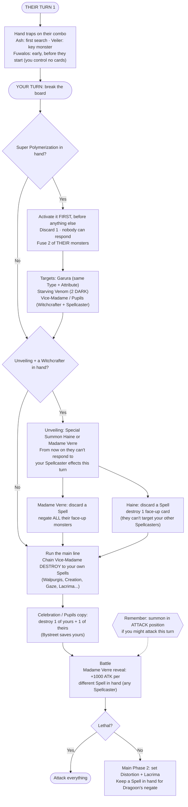

# Witchcrafter

Lewis's *WitchCrafterRd1604* (completed 20 Nov 2026). Based on murabitoC0115's Rating Duels 1604 list; Extra Deck has Mudragon and Starving Venom instead of Flame Wingman and a 2nd Vice-Madame. **W:P Fancy Ball** replaced Mudragon in the Extra Deck on 20 Nov. See [My decks](My-decks.md) and [Natasha](Natasha.md).

## Main line: Walpurgis (or Marka) + any discard → Dragoon

Source: **"The best combo (no bricks) and best endboard sequence"**, Dkayedstepson, MDM combo database (11 Nov 2026). Followed as published, with Fancy Ball.

**The key rule:** do the Extra Deck plays (Dark Magician of Destruction, Cross-Sheep, Dragoon) **before** Terracottan. Terracottan's hand effect stops you summoning anything but Witchcrafters from the Extra Deck for the rest of the turn.

1. **Walpurgis:** add **Witchcrafter Genni**, discard any card. (Marka start: Tribute Marka from hand → add Walpurgis first.)
2. Normal Summon **Genni**.
3. **Genni:** Tribute it; for the discard, Walpurgis sends **Celebration** from the Deck → Special Summon **Schmietta**.
4. **Schmietta:** Tribute it; Walpurgis sends **Distortion** → Special Summon **Marka**.
5. **Dark Magician of Destruction:** banish Marka (Level 6 DARK Spellcaster; a Spell was activated) → add **The Gaze of Timaeus**.
6. **Genni (GY):** banish Genni + **Celebration** → copy Celebration's Fusion mode → **Vice-Madame** (shuffle banished Spellcasters into the Deck).
7. **Schmietta (GY):** banish it → send **Marka #2** from the Deck to the GY. **Chain Vice-Madame** (Summon) → **Verre, the Maid of Endymion** from the Deck.
8. **Verre the Maid:** add **Creation**. **Chain Vice-Madame** (Add) → **Distortion** from the GY.
9. **Creation:** add **Terracottan**.
10. Link **Verre + Dark Magician of Destruction → Cross-Sheep**.
11. **Gaze of Timaeus:** target Dark Magician of Destruction in the GY → **Red-Eyes Dark Dragoon**, in a zone Cross-Sheep points to. **Cross-Sheep:** revive **Verre the Maid**.
12. Link **Verre + Cross-Sheep → W:P Fancy Ball**.
13. **Terracottan (hand):** add **Verre the Maid** from the GY → Special Summon Terracottan. Then **Terracottan:** Fusion Summon **Witchcrafter Pupils** (Terracottan + Verre from hand) → **Pupils:** add **Lacrima of Light**.
14. Set **Lacrima** and **Distortion**.
15. **End Phase: Pupils** returns a banished **Celebration** to the GY → **Celebration** adds itself to your hand.

**End:** Dragoon · Vice-Madame · Pupils · W:P Fancy Ball · set Distortion, Lacrima · Celebration in hand.

**Her turn (from the guide):** Pupils copies Celebration to destroy a card; Fancy Ball negates and banishes a monster; Dragoon negates by discarding Celebration; Lacrima's 2nd effect (on her activation) summons a Witchcrafter → chain Vice-Madame's destroy; Distortion negates anything.

## Flowchart

The main line and their-turn priorities as a diagram. ⛓ means chain Vice-Madame to that effect.

```mermaid
flowchart TD
    subgraph S["Starters (any 1)"]
        M["Marka in hand<br/>Tribute it"]
        C["Creation or Spell Power Mastery"]
        W0["Walpurgis in hand"]
    end
    C --> V0["Add Verre the Maid<br/>Special Summon her"] --> W0
    M --> W0
    W0 --> W1["1. Walpurgis<br/>add Genni, discard any card"]
    W1 --> G["2. Normal Summon Genni"]
    G --> G2["3. Genni: tribute<br/>Walpurgis sends Celebration<br/>→ Schmietta"]
    G2 --> S2["4. Schmietta: tribute<br/>Walpurgis sends Distortion<br/>→ Marka"]
    S2 --> D["5. Banish Marka<br/>→ Dark Magician of Destruction<br/>add Gaze"]
    D --> VM["6. Genni GY + Celebration<br/>→ Vice-Madame"]
    VM --> SG["7. Schmietta GY: send Marka #2<br/>⛓ Vice-Madame SUMMON → Verre the Maid"]
    SG --> VR["8. Verre: add Creation<br/>⛓ Vice-Madame ADD → Distortion"]
    VR --> CR["9. Creation: add Terracottan<br/>(keep in hand)"]
    CR --> X["10. Verre + Dark Magician<br/>→ Cross-Sheep"]
    X --> DR["11. Gaze → Dragoon<br/>on a Cross-Sheep arrow<br/>Cross-Sheep revives Verre"]
    DR --> FB["12. Verre + Cross-Sheep<br/>→ W:P Fancy Ball"]
    FB --> T["13. Terracottan: add Verre, summon itself<br/>Terracottan + Verre → Pupils"]
    T --> RQ{"Madame Verre in your GY?<br/>(discard her to Walpurgis in step 1)"}
    RQ -->|"No"| L1["Pupils adds Lacrima"]
    L1 --> SET["14. Set Distortion + Lacrima"]
    RQ -->|"Yes: big boss ending"| R1["Pupils adds Celebration"]
    R1 --> R2["Pupils reveals Celebration: Fusion<br/>shuffle Madame Verre + Verre + Terracottan from GY<br/>→ MADAME RILLIONA (3800)"]
    R2 --> R3["Rilliona: summon Haine from Deck<br/>(only 1 zone left)"]
    R3 --> SETR["14. Set Distortion<br/>Celebration stays in hand (only revealed)"]
    SETR --> EP
    SET --> EP["15. End Phase: Pupils returns Celebration<br/>Celebration adds itself to hand"]
    EP --> END(["END BOARD<br/>Dragoon · Vice-Madame · Pupils · Fancy Ball<br/>set Distortion + Lacrima · Celebration in hand"])

    RULE{{"Rule: Extra Deck plays BEFORE Terracottan<br/>(it locks you to Witchcrafter Extra Deck)"}}
    RULE -.-> X

    EP --> ENDR(["If Rilliona: + Rilliona · Haine, no Lacrima<br/>Rilliona revives herself in your End Phase if destroyed"])
    END --> OPP["THEIR TURN, in order"]
    OPP --> O1["1. Vice-Madame DESTROY<br/>on their first Spell / key card"]
    O1 --> O2["2. Pupils copies Celebration<br/>destroy 1 of theirs (Bystreet saves yours)"]
    O2 --> O3["3. Dragoon negate<br/>discard Celebration"]
    O3 --> O4["4. Lacrima → Haine from Deck<br/>(also triggers Vice-Madame)"]
    O4 --> O5["5. Distortion: negate the big play"]
    O5 --> O6["6. Fancy Ball: steal their Link-2 or lower"]
```

### When they interrupt you (going first)

Droll branch is Schwi 02 YT's MDM line "when hit by droll on field search using rilliona". The Veiler trick: Genni and Schmietta are Quick Effects, so chain them to the hand trap and the tribute cost moves them off the field first.

### Going second (board breaking)

## Other starters (MDM, then join the main line)

- **Marka + any discard** (Leon, 6 Sep 2026): Tribute Marka from hand → add **Walpurgis**. Then main line step 1.
- **Creation (or Spell Power Mastery) + any card** (Plushpuff, 23 Sep 2026): Creation → add **Verre, the Maid of Endymion**. Verre: Special Summon from hand (a Spell was activated this turn) → add **Walpurgis**. Then main line step 1. Creation is used up for the turn, so Plushpuff gets Terracottan through Vice-Madame / Endymion instead. If that's not available, have Walpurgis add Terracottan (UNTESTED).
- **Walpurgis + any discard**: the main line above (Dkayedstepson; Schwi's version is similar).

## Consistency (brick % going first, 5 cards, 300,000 sims, 21 Nov 2026)

Counts one-card starters **and two-card combos** (from card text):
- Witchcrafter: Walpurgis, Marka, Creation, Spell Power Mastery, Empire of Endymion; or Genni/Schmietta/Pittore/Potterie + any Spell; or Verre the Maid + Unveiling.
- Rikka: Petal, Black Princess, Glamour, Moonlit Waters, Foolish Burial; or Mudan / Konkon + Rikka Princess or Primula.
- Invoked: Aleister, Aiwass, Magical Meltdown, Sacred Spirit Sword (Reminiscent needs a Spellcaster or Fusion on the field, so it isn't a starter going first).
- Orcust: Girsu, Diabellstar, WANTED, Foolish Burial; or Deception + a monster.

| Deck | Brick |
| --- | --- |
| Witchcrafter (current, 1 SPM) | 10.2% |
| Witchcrafter, 3 Spell Power Mastery (cut Potterie, Crowley) | 7.9% |
| Witchcrafter, 3 SPM + 3 **Empire of Endymion** (cut Maxx "C", 1 Unveiling, 1 Lacrima) | **4.0%** |
| Rikka (xemnas43) | 11.4% |
| Invoked (Lewis's) | 14.9% |
| Orcust (Acil16_) | 27.0% (20 hand traps) |

- **Empire of Endymion** (R): "add Regulus or a monster that mentions it" → **Verre, the Maid of Endymion** (mentions Regulus) → Special Summon Verre (a Spell was activated) → Verre adds **Walpurgis**. Same route as umiii's MDM line. UNTESTED in Lewis's list.

## Card counts vs 30 recent top lists (MDM, 6–21 Nov 2026)

Average copies across the 30 most recent Master Duel Meta Witchcrafter lists, against Lewis's list. Only rows that differ.

| Card | Top lists (avg · % running it) | Lewis |
| --- | --- | --- |
| Witchcrafter Unveiling | 0.7 · 40% (17 of 30 run none; only murabitoC0115 runs 3) | 3 |
| Mulcharmy Fuwalos | 2.7 · 96% | 1 |
| Droll & Lock Bird | 1.7 · 86% | 0 |
| Verre Magic - Lacrima of Light | 2.3 · 96% | 3 |
| Effect Veiler | 1.2 · 50% | 2 |
| Super Polymerization | 1.0 · 50% | 2 |
| Witchcrafter Potterie | 0.2 · 23% | 1 |
| Witchcrafter Pittore | 0.4 · 36% | 1 |

**Suggested swap (UNTESTED):** −2 Unveiling, −1 Lacrima, −1 Effect Veiler → +2 Fuwalos, +2 Droll. Keep 1 Unveiling: it's the only way to Special Summon Madame Verre or Haine from hand. On its own it's a brick.

## 1701-rated list (9vyHwBpl5fOzPgl, Rating Duels, 21 Nov 2026)

[MDM link](https://www.masterduelmeta.com/top-decks/rating-duels/november-2026/witchcrafter/9vyhwbpl5fozpgl/Ile9D). Same engine as Lewis's list; the differences are 8 Main Deck cards.

- **Lewis runs, they don't:** Unveiling ×3, Effect Veiler ×2, Pittore, Crowley, Haine.
- **They run, Lewis doesn't:** Fuwalos +2 (3 total), Droll ×2, Spell Power Mastery +1 (2 total), PSY-Framegear Gamma + PSY-Frame Driver, Crossout Designator.
- **No Unveiling and no Haine.** Madame Verre (1) comes from the Deck via Genni / Schmietta / Potterie instead of from hand.
- **Extra Deck:** Mudragon, Garura, Favorite HERO Flame Wingman, Dark Magician of Destruction, Dragoon, Vice-Madame ×2, Secreterion Dragon, Madame Rilliona, Pupils, Artemis, Cross-Sheep, S:P Little Knight, Fancy Ball, Charmer Quartet in Bloom.

## Fundamentals

- **The chain:** Genni (Lv1) and Schmietta (Lv4) are Quick Effects. Tribute itself + discard a Spell → Special Summon another Witchcrafter from the Deck.
- **Walpurgis** replaces each of those discards with "send a Witchcrafter Spell/Trap from Deck to GY". No card loss, and it fills the GY for the GY effects.
- **GY value:** Genni banishes itself + a Witchcrafter Spell to copy it (Celebration's Fusion → Vice-Madame). Schmietta banishes itself to send any Witchcrafter (Marka) to the GY. Creation and Celebration return to hand in the End Phase if you control a Witchcrafter, so the deck grinds.
- **Vice-Madame:** three once-per-turn effects, triggered by **any** Spell or non-Fusion Spellcaster effect (yours or theirs). Chain one to everything.
- **Interruptions:** Distortion (needs a Level 5+ Witchcrafter on field), Lacrima's 2nd effect, Celebration/Pupils destroy, Dragoon negate, Fancy Ball, Marka from the GY.

## Lessons

- **20 Nov 2026 (solo):** the turn ended with no Dragoon because Terracottan was used before Dark Magician of Destruction. Order matters: Extra Deck plays first.
- Vice-Madame has **three** different effects, each once per turn. Chain one to each Spell or Spellcaster effect you activate.
- **Pittore's GY effect** banishes your whole hand if you hold no Witchcrafter card. Check first.
- **Summon in Attack Position if you might attack.** 20 Nov vs Luke: Madame Verre (Unveiling) and Pupils both went in Defense and couldn't attack. You can't change position the turn a monster is summoned.
- **Madame Verre's reveal works for ANY of your Spellcasters in battle** (+1000 per differently named Spell in hand). Keep spare Spells in hand on a lethal turn.
- **Haine is Level 7: 2 tributes.** Get it out with Unveiling instead.
- **Read the Walpurgis search list carefully:** adding Marka by mistake cost the Genni start (Pittore replaced it).
- **Genni's GY effect: pick Celebration, not Creation.** 21 Nov vs Luke: banishing Creation by mistake gave a search instead of Vice-Madame. Fix: activate Celebration from hand (Fusion mode) for Vice-Madame.
- **Make Cross-Sheep BEFORE Gaze.** Gaze returns Dark Magician of Destruction to the Extra Deck, so skipping Cross-Sheep loses Fancy Ball.
- **Unused Vice-Madame effects aren't wasted:** chain them later to Terracottan (Summon from hand), Pittore (Add) and Haine (Destroy).
- **Vs Cyber Dragon:** Clockwork Night makes every monster a Machine, so Chimeratech and Super Polymerization can use yours. Destroy it first. Pupils copying Celebration plus Bystreet is a free destroy.
- **Missed chain recovery:** if you forget to chain Vice-Madame to Schmietta, chain it to Gaze (Summon Verre the Maid), then to Verre's search (Add Distortion). You still end on Dragoon + Pupils + Lacrima + Distortion.
- **Lead with the search you can afford to lose** (21 Nov, twice). If your hand has Spell Power Mastery or Creation, use it before Walpurgis. Rhino's Chaos and savic's Dominus Purge both hit Walpurgis first, and without Walpurgis every Genni/Schmietta/Haine/Madame Verre cost is a real Spell from hand.
- **Pupils copying Celebration uses up Celebration for the turn** (21 Nov vs Rhino): Master Duel greyed out the Celebration in hand afterwards. Pick one: Pupils' copy, or activating it from hand.
- **Genni, the Maid of Endymion needs no discard:** Special Summon her while you control a Spellcaster, then banish a Spellcaster you control (herself is fine) → any Witchcrafter from the Deck. It's the engine that still works with Walpurgis gone.
- **Vs Dark Law (Rhino):** anything sent to your GY is banished, so Terracottan's hand effect and all GY effects are dead. Route: Spell Power Mastery → Genni, the Maid → Verre → Creation → Terracottan (Normal Summon) → Fusion.
- **Mulcharmy Fuwalos needs you to control no cards.** After going first it's dead.
- **Distortion needs a Level 5+ Witchcrafter on the field.** Vice-Madame (Level 8) counts.
- **Vs Blue-Eyes (True Light):** if True Light goes from the field to the GY, it destroys all their monsters. Haine or Vice-Madame on True Light is a board wipe. But **Blue-Eyes Spirit Dragon** negates one GY effect activation per turn, and it negated True Light's wipe. Kill Spirit Dragon first, or hit True Light after its negate is used. Ghost Belle negated Gaze (it targets Dark Magician of Destruction in the GY).

## Game log

| Date | Opponent | Turn | Result | Notes |
| --- | --- | --- | --- | --- |
| 21 Nov 2026 | IG:savic_r97 (Blue-Eyes, ranked) | 1st | **Lost** | Dominus Purge on Walpurgis's search, Veiler on Verre the Maid, Ghost Belle on Gaze. Still ended on Vice-Madame, Bystreet, set Distortion. Turn 3: 5900 damage (they were on 2100). Turn 5: Haine destroyed Indigo-Eyes; **Haine on True Light would have won** (it wipes their board). Turn 6: Haine hit True Light, but Spirit Dragon negated the wipe. Lost to their 4 big Dragons and the turn timer. |
| 21 Nov 2026 | Rhino (HEROes, friendly) | 2nd | Not recorded | His board: Chaos ×2, Sunrise, Dark Law, set Neos fusion. Chaos ×2 negated Walpurgis and Lacrima; Dark Law banished Celebration from hand; Shining Neos Wingman destroyed Bystreet and Walpurgis. Rebuilt: Spell Power Mastery → Genni, the Maid (Unveiling) → Verre → Creation → Terracottan → Pupils → Vice-Madame. Pupils' Celebration copy locked the Celebration in hand. |
| 21 Nov 2026 | KHAOTICA101 (Cyber Dragon) | 1st | **Won** | Full main line from Walpurgis + Pittore discard; end board Dragoon, Vice-Madame, Pupils, Fancy Ball, Bystreet, set Distortion/Lacrima. Their Clockwork Night turned the board into Machines (Chimeratech/Super Poly material): Pupils copied Celebration to destroy it, with Bystreet saving the Witchcrafter. |
| 21 Nov 2026 | Luke (Sky Striker, friendly) | 2nd | **Won** | Walpurgis + Spell Power Mastery start. Banished Creation instead of Celebration with Genni, and Gazed before Cross-Sheep; recovered with Celebration → Vice-Madame, Terracottan → Pupils, Pittore → Haine. Won turn 5. |
| 21 Nov 2026 | Luke (Sky Striker, friendly) | 2nd | **Won** | Full main line off Marka + Walpurgis. Kept Skull Meister alive until battle so his Sky Striker spells stayed off. |
| 20 Nov 2026 | Luke (budget Sky Striker, friendly) | 2nd | **Won** | Pittore start after a Walpurgis misclick. Luke Shark Cannoned Vice-Madame onto his field; leaving it there kept his Sky Striker spells off. Finish: Unveiling → Madame Verre; Terracottan → Pupils; Verre (switched to Attack) hit Lizardose with Madame Verre's reveal (+3000). |
| 20 Nov 2026 | Rhino (HEROes, friendly) | 1st | **Won** | Forgot to chain Vice-Madame to Schmietta's GY effect; used the recovery line above. End board: Dragoon, Vice-Madame, Pupils, Walpurgis, Bystreet, set Celebration/Distortion/Lacrima. Plan for his turn: Distortion on Mask Change; first target Masked HERO Dark Law. |

## Sources

- [MDM Witchcrafter combos](https://www.masterduelmeta.com/api/v1/combos?deckType=61f1a19b36e47a6c2237cfd0)
- [murabitoC0115's list](https://www.masterduelmeta.com/top-decks/rating-duels/november-2026/witchcrafter/murabitoc0115/ws4cG/)
