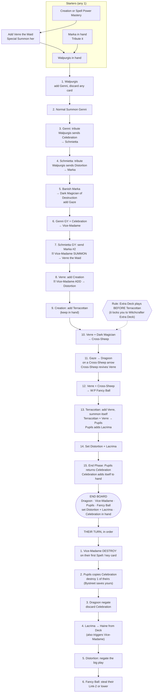

# Witchcrafter

Lewis's *WitchCrafterRd1604* (completed 20 Nov 2026). Based on murabitoC0115's Rating Duels 1604 list; Extra Deck has Mudragon and Starving Venom instead of Flame Wingman and a 2nd Vice-Madame. **W:P Fancy Ball** replaced Mudragon in the Extra Deck on 20 Nov. See [My decks](My-decks.md) and [Natasha](Natasha.md).

## Main line: Walpurgis (or Marka) + any discard → Dragoon

Source: **"The best combo (no bricks) and best endboard sequence"**, Dkayedstepson, MDM combo database (11 Nov 2026). Followed as published, with Fancy Ball.

**The key rule:** do the Extra Deck plays (Dark Magician of Destruction, Cross-Sheep, Dragoon) **before** Terracottan. Terracottan's hand effect stops you summoning anything but Witchcrafters from the Extra Deck for the rest of the turn.

1. **Walpurgis:** add **Witchcrafter Genni**, discard any card. (Marka start: Tribute Marka from hand → add Walpurgis first.)
2. Normal Summon **Genni**.
3. **Genni:** Tribute it; for the discard, Walpurgis sends **Celebration** from the Deck → Special Summon **Schmietta**.
4. **Schmietta:** Tribute it; Walpurgis sends **Distortion** → Special Summon **Marka**.
5. **Dark Magician of Destruction:** banish Marka (Level 6 DARK Spellcaster; a Spell was activated) → add **The Gaze of Timaeus**.
6. **Genni (GY):** banish Genni + **Celebration** → copy Celebration's Fusion mode → **Vice-Madame** (shuffle banished Spellcasters into the Deck).
7. **Schmietta (GY):** banish it → send **Marka #2** from the Deck to the GY. **Chain Vice-Madame** (Summon) → **Verre, the Maid of Endymion** from the Deck.
8. **Verre the Maid:** add **Creation**. **Chain Vice-Madame** (Add) → **Distortion** from the GY.
9. **Creation:** add **Terracottan**.
10. Link **Verre + Dark Magician of Destruction → Cross-Sheep**.
11. **Gaze of Timaeus:** target Dark Magician of Destruction in the GY → **Red-Eyes Dark Dragoon**, in a zone Cross-Sheep points to. **Cross-Sheep:** revive **Verre the Maid**.
12. Link **Verre + Cross-Sheep → W:P Fancy Ball**.
13. **Terracottan (hand):** add **Verre the Maid** from the GY → Special Summon Terracottan. Then **Terracottan:** Fusion Summon **Witchcrafter Pupils** (Terracottan + Verre from hand) → **Pupils:** add **Lacrima of Light**.
14. Set **Lacrima** and **Distortion**.
15. **End Phase: Pupils** returns a banished **Celebration** to the GY → **Celebration** adds itself to your hand.

**End:** Dragoon · Vice-Madame · Pupils · W:P Fancy Ball · set Distortion, Lacrima · Celebration in hand.

**Her turn (from the guide):** Pupils copies Celebration to destroy a card; Fancy Ball negates and banishes a monster; Dragoon negates by discarding Celebration; Lacrima's 2nd effect (on her activation) summons a Witchcrafter → chain Vice-Madame's destroy; Distortion negates anything.

## Flowchart

The main line and their-turn priorities as a diagram. ⛓ means chain Vice-Madame to that effect.

## Other starters (MDM, then join the main line)

- **Marka + any discard** (Leon, 6 Sep 2026): Tribute Marka from hand → add **Walpurgis**. Then main line step 1.
- **Creation (or Spell Power Mastery) + any card** (Plushpuff, 23 Sep 2026): Creation → add **Verre, the Maid of Endymion**. Verre: Special Summon from hand (a Spell was activated this turn) → add **Walpurgis**. Then main line step 1. Creation is used up for the turn, so Plushpuff gets Terracottan through Vice-Madame / Endymion instead. If that's not available, have Walpurgis add Terracottan (UNTESTED).
- **Walpurgis + any discard**: the main line above (Dkayedstepson; Schwi's version is similar).

## Fundamentals

- **The chain:** Genni (Lv1) and Schmietta (Lv4) are Quick Effects. Tribute itself + discard a Spell → Special Summon another Witchcrafter from the Deck.
- **Walpurgis** replaces each of those discards with "send a Witchcrafter Spell/Trap from Deck to GY". No card loss, and it fills the GY for the GY effects.
- **GY value:** Genni banishes itself + a Witchcrafter Spell to copy it (Celebration's Fusion → Vice-Madame). Schmietta banishes itself to send any Witchcrafter (Marka) to the GY. Creation and Celebration return to hand in the End Phase if you control a Witchcrafter, so the deck grinds.
- **Vice-Madame:** three once-per-turn effects, triggered by **any** Spell or non-Fusion Spellcaster effect (yours or theirs). Chain one to everything.
- **Interruptions:** Distortion (needs a Level 5+ Witchcrafter on field), Lacrima's 2nd effect, Celebration/Pupils destroy, Dragoon negate, Fancy Ball, Marka from the GY.

## Lessons

- **20 Nov 2026 (solo):** the turn ended with no Dragoon because Terracottan was used before Dark Magician of Destruction. Order matters: Extra Deck plays first.
- Vice-Madame has **three** different effects, each once per turn. Chain one to each Spell or Spellcaster effect you activate.
- **Pittore's GY effect** banishes your whole hand if you hold no Witchcrafter card. Check first.
- **Summon in Attack Position if you might attack.** 20 Nov vs Luke: Madame Verre (Unveiling) and Pupils both went in Defense and couldn't attack. You can't change position the turn a monster is summoned.
- **Madame Verre's reveal works for ANY of your Spellcasters in battle** (+1000 per differently named Spell in hand). Keep spare Spells in hand on a lethal turn.
- **Haine is Level 7: 2 tributes.** Get it out with Unveiling instead.
- **Read the Walpurgis search list carefully:** adding Marka by mistake cost the Genni start (Pittore replaced it).
- **Genni's GY effect: pick Celebration, not Creation.** 21 Nov vs Luke: banishing Creation by mistake gave a search instead of Vice-Madame. Fix: activate Celebration from hand (Fusion mode) for Vice-Madame.
- **Make Cross-Sheep BEFORE Gaze.** Gaze returns Dark Magician of Destruction to the Extra Deck, so skipping Cross-Sheep loses Fancy Ball.
- **Unused Vice-Madame effects aren't wasted:** chain them later to Terracottan (Summon from hand), Pittore (Add) and Haine (Destroy).
- **Vs Cyber Dragon:** Clockwork Night makes every monster a Machine, so Chimeratech and Super Polymerization can use yours. Destroy it first. Pupils copying Celebration plus Bystreet is a free destroy.
- **Missed chain recovery:** if you forget to chain Vice-Madame to Schmietta, chain it to Gaze (Summon Verre the Maid), then to Verre's search (Add Distortion). You still end on Dragoon + Pupils + Lacrima + Distortion.

## Game log

| Date | Opponent | Turn | Result | Notes |
| --- | --- | --- | --- | --- |
| 21 Nov 2026 | KHAOTICA101 (Cyber Dragon) | 1st | **Won** | Full main line from Walpurgis + Pittore discard; end board Dragoon, Vice-Madame, Pupils, Fancy Ball, Bystreet, set Distortion/Lacrima. Their Clockwork Night turned the board into Machines (Chimeratech/Super Poly material): Pupils copied Celebration to destroy it, with Bystreet saving the Witchcrafter. |
| 21 Nov 2026 | Luke (Sky Striker, friendly) | 2nd | **Won** | Walpurgis + Spell Power Mastery start. Banished Creation instead of Celebration with Genni, and Gazed before Cross-Sheep; recovered with Celebration → Vice-Madame, Terracottan → Pupils, Pittore → Haine. Won turn 5. |
| 21 Nov 2026 | Luke (Sky Striker, friendly) | 2nd | **Won** | Full main line off Marka + Walpurgis. Kept Skull Meister alive until battle so his Sky Striker spells stayed off. |
| 20 Nov 2026 | Luke (budget Sky Striker, friendly) | 2nd | **Won** | Pittore start after a Walpurgis misclick. Luke Shark Cannoned Vice-Madame onto his field; leaving it there kept his Sky Striker spells off. Finish: Unveiling → Madame Verre; Terracottan → Pupils; Verre (switched to Attack) hit Lizardose with Madame Verre's reveal (+3000). |
| 20 Nov 2026 | Rhino (HEROes, friendly) | 1st | **Won** | Forgot to chain Vice-Madame to Schmietta's GY effect; used the recovery line above. End board: Dragoon, Vice-Madame, Pupils, Walpurgis, Bystreet, set Celebration/Distortion/Lacrima. Plan for his turn: Distortion on Mask Change; first target Masked HERO Dark Law. |

## Sources

- [MDM Witchcrafter combos](https://www.masterduelmeta.com/api/v1/combos?deckType=61f1a19b36e47a6c2237cfd0)
- [murabitoC0115's list](https://www.masterduelmeta.com/top-decks/rating-duels/november-2026/witchcrafter/murabitoc0115/ws4cG/)
