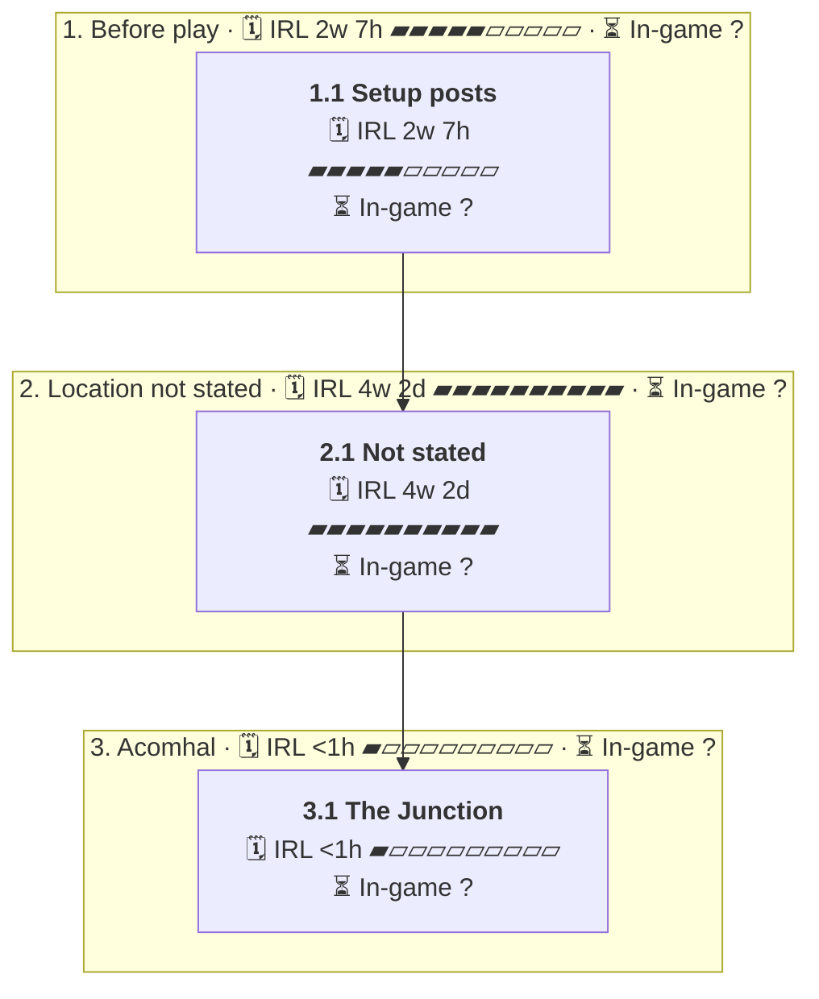

# C10 The Junction: Timeline

Where the party went, in order. Each outer box is an area, and each box inside it is a room or spot the party spent time in.

- 🗓️ **IRL** is measured from the first post there to the first post at the next place.
- ⏳ **In-game** time is filled in by the GM. An area's total appears once all of its rooms have one.

## 1. Before play

- 🗓️ **IRL:** 30 Aug 2026 to 30 Aug 2026, 2w 7h
- ⏳ **In-game:** not all rooms filled in

### 1.1 Setup posts

- 🗓️ **IRL:** 30 Aug 2026 to 30 Aug 2026, 2w 7h, 8 posts
- ⏳ **In-game:** not filled in (`"2026-08#1"` in `timelines/C10-The-Junction.json`)

**Events**

- 30 Aug: GM said they were still looking for players [↗](https://t.me/Path_Wars/146645/176282)
- 30 Aug: Anthony said no [↗](https://t.me/Path_Wars/146645/176283)
- 30 Aug: Anthony said don't [↗](https://t.me/Path_Wars/146645/176285)
- 30 Aug: Anthony told GM to finish Kibwe [↗](https://t.me/Path_Wars/146645/176288)

## 2. Location not stated

- 🗓️ **IRL:** 13 Sep 2026 to 6 Oct 2026, 4w 2d
- ⏳ **In-game:** not all rooms filled in

### 2.1 Not stated

- 🗓️ **IRL:** 13 Sep 2026 to 6 Oct 2026, 4w 2d, 12 posts
- ⏳ **In-game:** not filled in (`"2026-09#1"` in `timelines/C10-The-Junction.json`)

**Events**

- 14 Sep: Acomhal, a trade hub in the Eel Sea where many species and factions compete for trade, was introduced. [↗](https://t.me/Path_Wars/146645/179038)
- 25 Sep: Gloine Mhargadh, the Glass Market, was described as the richest faction, speaking through Ciarán, a Moth-Person. [↗](https://t.me/Path_Wars/146645/181305)
- 25 Sep: Na hIarannaigh, the Iron Ones, were described as the city's machine-keepers, speaking through Aisling, a Beetle-Person. [↗](https://t.me/Path_Wars/146645/181306)
- 25 Sep: Clann Deamhan, the Demon Clan, was described as proud, protective of its enclave, and speaking through Tómas, a Flame-Deamhan. [↗](https://t.me/Path_Wars/146645/181308)
- 25 Sep: Comhairle Acomhal, the Council, was described as slow to act, with Peadar, a Turtle-Person, sitting on it. [↗](https://t.me/Path_Wars/146645/181310)
- 25 Sep: An Crosbhealach was described as a place where rivals sit at the same tables and outside conflicts stay outside. [↗](https://t.me/Path_Wars/146645/181311)
- 01 Oct: The GM described the Eel Sea and the Glass Eel, custodian of reality that judges none of it. [↗](https://t.me/Path_Wars/146645/182264)
- 06 Oct: A Glass Elver followed the party, serving the Eel of the Delta, and the party was asked which channel to choose. [↗](https://t.me/Path_Wars/146645/183303)

## 3. Acomhal

- 🗓️ **IRL:** 14 Oct 2026 to 14 Oct 2026, <1h
- ⏳ **In-game:** not all rooms filled in

### 3.1 The Junction

- 🗓️ **IRL:** 14 Oct 2026 to 14 Oct 2026, <1h, 7 posts
- ⏳ **In-game:** not filled in (`"2026-10#3"` in `timelines/C10-The-Junction.json`)
- 💬 **Time said in posts:** "Late morning"; "this morning"

**Events**

- 14 Oct: Caravans and ships from a dozen worlds arrived at once at the Junction, and their cargo spilled into the streets. [↗](https://t.me/Path_Wars/146645/185507)
- 14 Oct: Glass Market couriers carried crates of Vitreous under armed guard. [↗](https://t.me/Path_Wars/146645/185508)
- 14 Oct: Iron Ones mechanics walked the loading cranes, tightening bolts. [↗](https://t.me/Path_Wars/146645/185509)
- 14 Oct: An Fás traders sold baskets of fruit that were still growing, while Shopkeepers called out ever-lower prices. [↗](https://t.me/Path_Wars/146645/185510)
- 14 Oct: The Council's bell rang the hour, and nobody looked up. [↗](https://t.me/Path_Wars/146645/185511)
- 14 Oct: The party's location in Acomhal was named as the Junction. [↗](https://t.me/Path_Wars/146645/185513)
